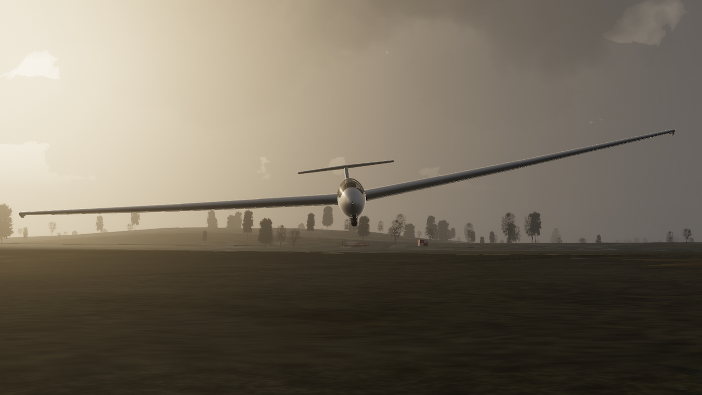

# ASK 21 for FlightGear, with a JSBSim model built from the test reports

The Schleicher ASK 21 two-seat trainer from FlightGear's aircraft
collection, with a new JSBSim flight model. The aerodynamics are built up
piece by piece from the glider's geometry and airfoils, and then checked
against what the real glider is documented to do:

- the US Air Force Flight Test Center's stall and spin evaluation
  (AFFTC-TR-89-27, 1989),
- the manufacturer's flight manuals, including the speed polar and the
  rigging data,
- a few things every ASK 21 pilot knows, like the glider lifting off
  hands-free before the tug does.

How it was built, and a test-by-test comparison of this model and the
standard FlightGear one against those sources, is in the report:
[ASK21-JSBSim-model-report.pdf](ASK21-JSBSim-model-report.pdf).

The wings bend, with the stiffness a ground vibration test of the real
glider measured, and the 3-D model's wings bend with them. What you hear
of the air is computed from the glider's shape by
[PyWopWop](https://github.com/MrChillStorm/PyWopWop), and every other
sound plays at the level the real thing makes.

The cockpit is reworked too, around a new LXNAV V8 vario, and the drag
robot tows like a real tug: it reacts to the pull of the rope, keeps
clear of hills and can take you around a landing pattern.

What changed in each update: [CHANGELOG.md](CHANGELOG.md).

## Install

Get the files:

```bash
git clone https://github.com/MrChillStorm/ASK21.git
```

Then add the cloned `ASK21` folder in the FlightGear launcher under
Add-ons → Additional aircraft folders (or start FlightGear with
`--fg-aircraft=` pointing at it), and pick **ASK 21 Glider JSB** or
**ASK 21mi Motorglider JSB**.

- The aircraft itself is in the `ASK21_v9` folder, so it sits next to
  the standard ASK 21 from the hangar without replacing it.
- In multiplayer, other pilots need this aircraft installed to see your
  glider as an ASK 21.
- The YASim variants (**ASK 21 Glider (YASim)** and the YASim
  motorglider) keep their original flight model, apart from the nose
  wheel (see below). The cockpit, the sound and the tow work the same
  in them; the tug's wake and the wing bending need JSBSim.

## Flying it

- **Take-off.** As in the real glider, set a little nose-down trim for
  the aerotow: it lifts off by itself before the tug, at about 75–80
  km/h. With the trim neutral it floats up early and you hold it down
  with a slight push.
- **Stalls and spins.** At forward centre of gravity you run out of
  elevator before the wing stalls, as in the real glider; further aft
  the stall breaks and can pitch down hard if you go looking for it.
  Whether it spins, and for how long, depends on the loading the same
  way as in the AFFTC tests: at forward centre of gravity it won't keep
  spinning, at aft centre of gravity it does. The manual's recovery
  stops the spin in half to three-quarters of a turn.
- **Wings.** They bend: the tips rise about 17 cm in level flight and
  more in a pull-up, and they sag 8 cm on the ground. The bending adds
  to the dihedral, so the glider rolls a little more slowly and holds
  the wings level a little more firmly than a rigid one would.
- **Slips.** Full rudder gives up to about 45° of sideslip and sinks
  faster than full airbrakes at the same speed.
- **Ground.** The glider rests on its nose and main wheels at the
  attitude of the manufacturer's rigging drawing, where both wheels are
  level. The standard model sits about 1.4° more nose-down.

## Cockpit

The front panel of the glider:

- **LXNAV V8 vario**, a new instrument in place of the ILEC SC7 vario
  and the separate G-meter. Pages for climb (vario, netto, relative and
  average), MacCready speed to fly, horizon, wind, FLARM radar, thermal
  assistant and G-meter, the vario and speed-to-fly audio, and the setup
  menu. Click the screen, or use ASK21 → LXNAV V8 close-up, for a larger
  view. It powers from the battery like the real unit. Netto and speed to
  fly use the flight manual's polar, scaled with the glider's mass, the
  g-load and the air density, so netto reads zero in still air at any
  speed, loading and height.
- **Spoken messages** like "Thermal average 2.1" or "Traffic 2 o'clock,
  high, 400 meters" are spoken by FlightGear's own speech synthesis. The
  buttons and menus are described in
  [the V8's README](ASK21_v9/Models/Interior/Panel/Instruments/lx-v8/README.md).
- **Take-off check placard** at the bottom right: loading, canopy,
  straps, controls, trim, airbrakes, instruments, radio, rope, wind.
- **Transponder** (BXP 6401) in place of the turn indicator. To get the
  turn indicator back, untick "Enable transponder" under ASK21 →
  Simulation Options.
- The altimeter sits under the airspeed indicator and the mechanical
  vario at the top right. The FLARM display at the top of the panel is
  gone; its traffic is on the V8's FLARM page.
- Black leather panels and glare shields, and all instruments' screws in
  one style. The scripts in `ASK21_v9/Models/Interior/Panel/src` make
  these from copies of the original meshes.
- **Yaw strings** of red wool taped on the outside of both canopies,
  lying along the glass. Each shows the airflow where it is taped: the
  sideslip, plus the swing of the nose when the glider yaws or rolls,
  so in a turn the front string reads a little differently from the
  glider as a whole, and gusts reach it straight from the wind field.
  The wool quivers like the real thing: a little in smooth air, more in
  turbulence, and a lot on the take-off run. They show on macOS too,
  and keep their length when they point straight back.

The motorglider's front panel gets the same changes, with the V8 at the
bottom right and no placard. The rear panel gets the leather and the
screws; its instruments stay as they were.

## Aerotow

The drag robot (ASK21 → Drag Robot) is the AI tug that tows you up.

- **Tow types.** 500 m and 1000 m tows climb to that height above the
  start with a few turns on the way, and release you there. The landing
  pattern tows, left or right, take you to 250 m at the start of the
  downwind leg: 500 m beside the runway, abeam its far end, heading back
  to the start. A custom height on the slider is still there.
- **Terrain.** Every second the tug looks 100 seconds ahead along the
  path it plans to fly. If that path doesn't clear the ground, it turns
  away the shorter way and rolls out when the way ahead is clear. A
  landing pattern tow then plans its pattern again, or turns into a
  normal tow when there's no room for one. The check can be switched
  off under Advanced Drag Robot Configuration. Either way, the tug makes
  no turns until it is 50 m above the start.
- **No more rubber band.** The tug feels the rope: a sudden pull slows it
  down the way it would slow a real 850 kg tug, and it gets back to
  speed over about 6 seconds. Its acceleration also builds up and fades
  out gently. Together these stop the glider surging back and forth on
  the rope.
- **Take-off run.** The tug lines up with the runway it stands on, lifts
  off at 100 km/h, stays low in ground effect until 115 km/h and then
  builds up its climb to at most 2.5 m/s. All of these can be changed
  under Advanced Drag Robot Configuration.
- **The tug's wake.** The tug leaves a real wake where it flew,
  drifting with the wind and sinking: its propeller slipstream (faster
  air, swirling and turbulent) and the two trailing vortices of its
  wing. Every part of the glider feels the air of the wake where it is.
  In high tow you are above it and calm; drop into it and it gets rough
  and you sink, slide sideways and it rolls you. On the take-off run the
  slipstream blows straight back at you. The strength is set under
  Aerotow Settings.
- **Rope.** 50 m long, instead of FlightGear's default of 60 m.
  FlightGear treats the tow rope as a soft spring, so under the tug's
  pull it stretches far more than a real rope does: the 50 m rope tows
  at about 60 m. A real rope stays close to its own length.
- If the chosen tug model isn't installed, the robot uses the next one it
  finds (DR400, PA28, Ercoupe, Staggerwing).

## Sound

- **The air.** PyWopWop computes the glider's sound from its shape: the
  hiss of the canopy's boundary layer in the cockpit, the wing and
  tail's own noise, the rumble the airbrakes add, the ailerons' in a
  roll, and the stall, in the cockpit and outside, from 40 to 150 kt.
  Aerobatics too: the stall when pulling up to 5 g, inverted flight and
  its stall. In a slip, up to 50 degrees, the glider is an airbrake: the
  flow separates off the fuselage and the cockpit's walls and its wake
  falls on the wing and tail, and the canopy's wind moves to the leeward
  side (these levels are estimates: no recording of a full slip has
  tested them yet). At altitude the
  same indicated airspeed is a faster, thinner flow: each sound's level
  and pitch follow PyWopWop's own physics for that (at 3 km the wing is
  about 3.5 dB louder, everything a little higher).
- **Everything else** plays at the level it makes, on the same scale:
  the tyres rumbling, the touchdown, the wheel brake, the airbrakes'
  lock, the releases, the canopy windows and the varios. Outside you
  hear the tyres and the releases too, fading with distance. An open
  sliding window adds the wind through it.
- The made-up sounds of the original (a howl at low speed, a whoosh when
  pitching) are gone.

## How it compares

Every number below comes from the same scripted test programme flown
with both models (details and sources in the report).

| | Source | Standard FlightGear model | This model |
|---|---|---|---|
| Polar rms error, 470 / 570 kg | flight manual | 0.09 / 0.17 m/s | 0.025 / 0.030 m/s |
| Best glide ratio | 33.5 | 42 | 32.6–32.7 |
| Stall speed single / dual | 65 / 74 km/h | 60.3 / 69.3 | 63.9 / 72.8 |
| Neutral point | aft of 18.46 in | 16.5 in (unstable at aft CG) | 22.1 in |
| Forward-CG stall | elevator runs out first | elevator runs out first | elevator runs out first |
| Inverted −1 g stall | 38–40 KIAS | 54 | 40.6 |
| AFFTC spin map, 24 loadings | AFFTC | 2 right (spiral dives) | 20 right |
| Spin rate / height lost per turn | 80–140 °/s / 200 ft | no spin | 104 °/s / 291 ft |
| Recovery with the manual's procedure | under 1 turn | no spin | 0.53–0.76 turn |
| Full-rudder sideslip | up to 50° | 16° | 46° |
| Full-aileron roll, first 180° | about 5 s | 6.2–6.6 s | 4.5–4.8 s |
| Hands-free aerotow lift-off (tug 85 km/h) | before the tug, about 75 | 91–108 km/h | 66–80 km/h |
| 45° airbrake dive at 600 kg | 232 km/h | 194 | 232 |
| Wing bending, glider on springs | ground vibration test: 2.95 / 6.50 Hz | rigid | 2.95 / 6.0 Hz |

## Known gaps

- **Phugoid.** Below about 115 km/h the slow pitch-and-speed
  oscillation is very slightly unstable on paper: with the stick held
  perfectly still it grows over a few cycles. In flight it doesn't show
  as porpoising; you damp it without noticing.
- **Spins** lose about 291 ft per turn against the AFFTC's 200 ft, and
  the nose bobs more than reported. At one heavy loading (two pilots and
  tail ballast, centre of gravity 14.2 in) the spin builds up more
  slowly than in the tests.
- **Stalls** at aft centre of gravity drop the nose about 8° where the
  AFFTC saw 2–3°. Dynamic stalls from a steep nose-up attitude drop the
  nose further than reported.
- **Not modelled:** controls that float free when released, airspeed
  indicator errors, and the wing's twisting and its higher bending
  modes.

## Rebuilding the model and the report

The [`fdm`](fdm) folder holds everything that produced the flight model
and the report, and regenerates both exactly. It needs Python 3.12 or
newer with `jsbsim` 1.3, `numpy`, `scipy`, `matplotlib`, `aerosandbox`,
`neuralfoil` and `cma`, and [tectonic](https://tectonic-typesetting.github.io)
or another XeLaTeX for the PDF.

```bash
cd fdm
python3 genxml.py ../ASK21_v9/Systems/ask21-aero.xml "$(cat v9_params.json)"
python3 genjsb.py ../ASK21_v9/ask21-jsb.xml
python3 flexwing.py --write
```

- `genxml.py` writes the aerodynamics: 22 wing strips, 6 tailplane and 3
  fin strips, and 11 fuselage stations, with the parameters in
  `v9_params.json`, and the tug's wake (`Systems/ask21-wake.xml`).
  `genjsb.py` writes the mass, gear and controls file.
- `flexwing.py` works out the wing panels' bending from the ground
  vibration test and writes its system (`Systems/ask21-flex.xml`), the
  3-D wings' bending and the wing cameras.
- `FDM_HZ=240 python3 campaign.py v9` and `campaign.py fg` fly the
  186-point test programme with each model, at its rate in FlightGear
  (about a minute on 8 cores), and store the results in
  `results_v9.json` and `results_fg.json`.
- `figures.py`, `mktables.py`, `paradox.py`, `mknumbers.py`, `mkscore.py`
  and `mktab_a1.py` turn the results into every figure, table and number
  in the report; `tectonic ask21_report.tex` builds the PDF.
- `optimize.py` and `optimize2.py` with `objective.py` identified the
  post-stall parameters against the AFFTC spin results, the last time
  with the wing bending at 240 Hz; `opt_final.json` is the chosen
  candidate.
- `FG_ROOT=<FlightGear's data> python3 airsound.py <PyWopWop>/out/ask21`
  writes the sound from PyWopWop's bank (`pywopwop glider-bank ask21`):
  its loops with their altitude laws, and every other sound's level
  (a few minutes: it runs PyWopWop's model for every condition).
- `fg_*.xml` are the unmodified files of the standard FlightGear model,
  used for the comparison.

The flight manuals and the AFFTC report are not included; the report
lists them as sources.

## Changes to the FlightGear aircraft

Based on the ASK 21 in FlightGear's aircraft repository (FGAddon,
revision 8166). Changed in 2026, all inside `ASK21_v9`:

- **Folder.** Renamed from `ASK21` to `ASK21_v9`; the `Aircraft/ASK21/`
  paths inside its files point to the new name.
- **Flight model.** `Systems/ask21-aero.xml` is replaced by the
  generated aerodynamics (also used by the JSBSim motorglider).
  `ask21-jsb.xml` gets the mass properties and inertias from the AFFTC
  report, a cockpit ballast station, the control travels from the
  rigging data and the pitch control without a stick map. The
  aerodynamics read the tug's wake as airflow at every station
  (`Systems/ask21-wake.xml`; the system files `Systems/ask21-fcs.xml`
  and `Systems/ask21mi-fcs.xml` declare its inputs). The wings bend
  (`Systems/ask21-flex.xml`), and the tip skids and the ground-handling
  wing supports follow the bent tips. Both JSBSim versions run at 240 Hz
  (`ask21-jsb-set.xml`, `ask21mi-jsb-set.xml`).
- **Wing bending, 3-D.** The 3-D model's wings bend as the flight model's
  do (`Systems/jsb_wingflex.xml`, the animations and multiplayer
  properties in `Models/ask21.xml` and `ask21-main.xml`), and the wing
  cameras ride on them (`Systems/wingflex_view.xml`). The YASim versions
  keep FlightGear's generic wing flexer (`Systems/yasim_wingflex.xml`).
- **Motorglider.** `ask21mi-jsb.xml` has the glider's mass properties
  and inertias plus 80 kg for the power plant; it had the original
  model's, too small for flexible wings.
- **Sound.** `Sounds/ask21-sound.xml` plays PyWopWop's computed airflow
  (`Sounds/pywopwop`) in place of the original wind, airbrake, howl and
  whoosh sounds, and every other sound at its physical level;
  `Systems/sound.xml` tells it how far the sliding windows are open.
- **Nose wheel.** 5.4 cm lower in all four flight models (`ask21-jsb.xml`,
  `ask21mi-jsb.xml`, `ask21.xml`, `ask21mi.xml`) and in the 3-D model
  (`Models/ask21.xml`), so the glider sits as the rigging drawing shows.
- **Cockpit.** New: the V8 (`Models/Interior/Panel/Instruments/lx-v8`,
  with `Sounds/lxv8-tone.wav`), the placard (`Instruments/placard`), the yaw
  strings (`Models/Interior/yawstring` and `Nasal/yawstring.nas`, in
  place of FlightGear's standard yaw string script in `Nasal/ask21.nas`)
  and the scripts in `Models/Interior/Panel/src`. Changed: the panels
  (`Models/Interior/Panel/panel*.xml` and `panel*.ac`), the glare
  shields in `Models/Interior/interior.ac`, the yaw strings' places in
  `Models/Interior/interior.xml`, the screws and textures of the
  airspeed indicator, altimeter, varios, compass and turn indicator, the
  V8's sounds in `Sounds/ask21-sound.xml`, the V8 and transponder loads in
  `Nasal/electrical.nas` and `Nasal/electrical-mi.nas`, the transponder
  in `Nasal/ask21.nas` and `Systems/ask21-instrumentation.xml`, its
  option in `gui/dialogs/options.xml`, and the menu entry, settings,
  voice and scripts in `ask21-main.xml`.
- **Aerotow.** `Nasal/dragrobot.nas` (tow types, terrain, the tug's
  reaction to the rope, take-off run) with its dialogs
  `gui/dialogs/dragrobot.xml` and `dragrobot_advanced.xml`, the new
  `Nasal/propwash.nas` (the tug's wake) with its strength slider in
  `gui/dialogs/aerotow.xml`, and the 50 m rope in `ask21-main.xml`.
- **Fixes** to bugs of the original aircraft:
  - `ask21-main.xml` loaded `immat.nas` and `te-vario.nas` under the
    same index, so the registration letters never followed the
    callsign or the Immatriculation dialog. And the `-set` files loaded
    their own scripts under `te-vario.nas`'s index, so the rear seat's
    vario never moved.
  - `Nasal/electrical.nas` and `electrical-mi.nas`: the low-battery
    warning used an undefined variable, which stopped the battery at
    10 %; the glider's ammeter always showed charging.
  - `Systems/instruments.xml`: a blocked pitot gave zero total pressure
    instead of the slowly leaking one; the airspeed indicator now drops
    to zero in a full slip, as the flight manual says.
  - `Nasal/limits.nas`: the g, VNE and weight warnings stopped after a
    replay, the weight warning never worked with JSBSim, and the airbrake
    limit of +3.5 g / 0 g (flight manual II.5) was missing.
  - `Nasal/groundhandling.nas`: the tutorial's altimeter check took QFE
    for a wrong setting (a misspelled property, a copy-paste error and
    mixed-up logic).
  - `Nasal/jsoverride.nas`: joystick button 1 still releases the cable,
    but its own bindings are replaced instead of added to, and the new
    option "Joystick button 1 releases the cable" in Simulation Options
    switches this off.

Everything else is as its authors made it; they are credited in
[ASK21_v9/README.md](ASK21_v9/README.md).

## Licence

GNU General Public License, version 2 or (at your option) any later
version, the same as the original aircraft. See [COPYING](COPYING).
